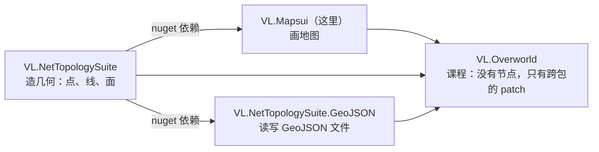
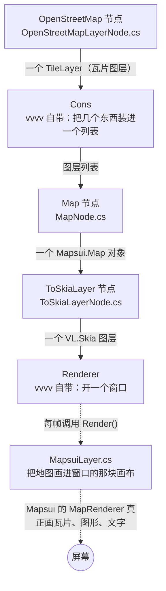
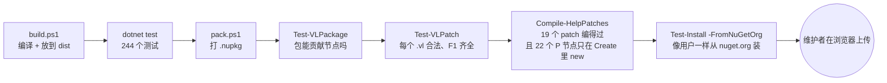

# VL.Mapsui 读懂指南

写给懂一点 JavaScript、不会 C# 的人：先讲整体，再讲一条数据怎么流到屏幕上，最后带你读真正的代码，每段
C# 旁边都附了 JS 写法。写于 2026-10-17，对应工作版本 0.0.2-alpha。

默认地图中心 139.7°E, 35.68°N（东京）· 缩放级别 12 · 瓦片路径 `{zoom}/{x}/{y}.png`

---

## 1. 这个项目是什么

**一句话：**把一个叫 [Mapsui](https://mapsui.com) 的 C# 地图引擎，包装成 vvvv 里可以拖拽连线的节点。

| 本项目里的东西 | JS 世界里最像的 |
|---|---|
| Mapsui（被包装的库） | Leaflet / OpenLayers：一个画地图的引擎 |
| vvvv gamma | Node-RED、Blender 节点编辑器：连线编程的环境，每秒运行 60 次 |
| 一个“节点” | 一个函数或一个类，被画成方块，参数是方块上的“pin”（输入口、输出口） |
| 一个 patch（`.vl` 文件） | 一张连好线的节点图，存成 XML |
| VL.Mapsui 这个包 | 一个 npm 包：`src/` 是源码，`help/` 是示例，发布到 nuget.org（C# 的 npm） |
| NetTopologySuite（NTS） | Turf.js：处理点、线、多边形的几何库 |

所以这个仓库里有三种东西：**C# 代码**（节点本身）、**帮助 patch**（教人用节点的示例图），以及**保证这两样不出错的脚本和文档**。按行数算，代码和测试大约各占四分之一，剩下是文档和工具脚本。

## 2. 四个仓库，各管一件事

它们互相之间**没有引用**，靠共用同一个几何库 NetTopologySuite 拼在一起，就像几个 npm 包都依赖同一个版本的 Turf.js，所以彼此的数据能直接传。



> **规则：**只用到一个包的帮助 patch 放在那个包的 `help/` 里；用到两个以上的，放到 VL.Overworld。原因是 `help/` 会被打进包里发布，如果里面引用了别的包，只装了 VL.Mapsui 的用户打开就是一片红。

VL.Mapsui 对 VL.NetTopologySuite 有一个真正的依赖（nuspec 里写着），因为 `FeatureLayer` 吃的 `Feature` 类型是 NTS 那边定义的。这也是为什么发布顺序是先 NTS、后 Mapsui。

## 3. 一张地图是怎么画到屏幕上的

README 里说最小的地图只要 5 个节点：



翻译成 JS（示意）：

```js
// 一帧里发生的事
const tileLayer = osmNode.update({ enabled: true });   // 1. 拿到一个瓦片图层
const layers    = [tileLayer];                          // 2. Cons：装进数组
const map       = mapNode.update({ layers });           // 3. 组装成一张地图
const skiaLayer = toSkiaNode.update({ map });           // 4. 包装成 vvvv 能画的东西
renderer.draw(skiaLayer);                               // 5. 画到窗口里
```

其他节点都是往这条管道上**加东西**：

- **更多图层**：`XYZ`（任意瓦片服务）、`Geometry`、`FeatureLayer`（你自己的数据）、`Graticule`（经纬网），都塞进 Cons。
- **样式**：`VectorStyle`、`SymbolStyle`、`LabelStyle`……接到图层的 Style 口。
- **移动地图**：`Navigate` 类的节点接在 Map 后面，吃一个 Map、改它的视角、再吐出同一个 Map。
- **问地图**：`Pick`（鼠标下面是哪个要素）、`ViewportInfo`（现在看哪里）。

> **一个设计决定：鼠标不在节点里。**ToSkiaLayer 不处理鼠标。你在 patch 里用 vvvv 自带的 MouseState 读鼠标，再连到 `Drag`、`ZoomByWheel`。好处是同一张地图也可以被 LFO、OSC 消息、键盘驱动。代码里对应 `MapsuiLayer.Notify` 永远返回 `false`，意思是“这个事件我不接”。

## 4. 最重要的一件事：vvvv 每秒把整张图跑 60 遍

这是读懂这个项目所有代码的钥匙。vvvv 不是“点一下按钮运行一次”，而是像游戏引擎或者 `requestAnimationFrame` 一样，**每一帧把整张节点图从头到尾执行一遍**。于是节点有两种写法：

**静态方法（static）≈ 普通函数**，每帧都被调用，没有记忆。适合纯计算：输入一样，输出就一样。

```js
function ScreenToWorld(map, x, y) {
  return map.toWorld(x, y);
}
```

**[ProcessNode] 类 ≈ 有状态的对象**。打开 patch 时 `new` 一次（Create），之后每帧调 `update`（Update）。适合**持有资源**的东西：网络连接、缓存、文件。

```js
const osm = new OpenStreetMapLayerNode();     // Create：只一次
setInterval(() => osm.update(/*...*/), 16);   // Update：每秒 60 次
```

如果你写过 React：静态节点就像写在组件 render 里的普通计算，ProcessNode 就像用 `useRef` 存住的那个对象，不会每次渲染都重新创建。

> **真实事故（2026-08）：**最早的地图节点写成了静态方法。每帧都新建一个瓦片图层，每个图层都开新的网络连接、从不释放。13 分钟开了 17,000 个 TCP 连接，耗尽了电脑的 16,384 个端口，**把作者家里的网络搞断了**。同一个 bug 也是“地图一直是空白”的原因：瓦片下载回来时，它要填的那张地图早已被丢掉了。

由此推出的几条规则：

- **只有“瓦片来源变了”才允许重建。**拖动地图每帧都在变中心点，如果“中心变了就重建”，拖一下就等于每帧重建。所以移动走 `Navigator.CenterOn`，不走重建。
- **Enabled 默认关闭。**打开一个 patch 就等于运行它，默认开着的话，用户还没同意就开始从 OpenStreetMap 下载了。
- **比较“是不是同一个”要小心。**vvvv 判断“变没变”看的是对象身份（JS 的 `===`），而静态节点每帧都返回新对象。所以 `FeatureLayer` 按*内容*比较要素（`SameFeatures`），不然每帧都以为变了，地图就会闪。
- **`Layers Built` 输出口**应该到 1 就停，一直涨就立刻关掉 vvvv。

## 5. 给 JS 读者的 C# 速查

| C# | JS / TS 里的意思 |
|---|---|
| `using Mapsui.Layers;` | `import ... from "mapsui/layers"` |
| `using ILayer = global::Mapsui.Layers.ILayer;` | 起别名的 import。`global::` 意思是“从最顶层找”，因为我们自己的命名空间叫 VL.Mapsui，会遮住真正的 Mapsui |
| `namespace VL.Mapsui;` | 这个文件属于哪个“模块”，决定节点在 vvvv 里的分类 |
| `public class MapNode : IDisposable` | `export class MapNode implements Disposable`（TS） |
| `[ProcessNode(Name = "Map", Category = "Mapsui")]` | 装饰器 `@ProcessNode({...})`，告诉 vvvv“这个类是一个节点” |
| `TileLayer? _layer;` | `#layer: TileLayer \| null`，`?` 表示可以是 null；下划线开头是私有字段的习惯写法 |
| `bool enabled = false`（参数） | 带默认值的参数。**在 vvvv 里，这就是 pin 打开时的初始值** |
| `out int layersBuilt` | 多一个返回值，JS 会写成 `return { layer, layersBuilt }`。**每个 out 参数就是一个输出 pin** |
| `cache ?? TileCache.Default()` | 和 JS 一样：左边是 null 就用右边 |
| `_source ??= x;` | 为空才赋值 |
| `x is null` / `x is not null` | `x === null` / `x !== null` |
| `ReferenceEquals(a, b)` | `a === b`（对象是不是同一个） |
| `src is HttpTileSource http` | `if (src instanceof HttpTileSource) { const http = src; }` |
| `public void Dispose() => Release();` | 箭头写法的方法。Dispose 是“临终清理”，vvvv 删掉节点或关闭 patch 时调用 |
| `.Where(...).Select(...).ToArray()` | `.filter(...).map(...)`（LINQ） |
| `$"layers {count}"` | 模板字符串 `` `layers ${count}` `` |
| `/// <summary>...` | JSDoc。vvvv 会把它显示成节点和 pin 的提示文字，所以这里的英文是给用户看的 |
| `internal` | 只在本包内部可见。测试能看到（`InternalsVisibleTo`），用户在 vvvv 里看不到 |
| `public static` | 不需要 new 就能调的函数。**在 vvvv 里会变成一个每帧执行的节点** |

> **口诀：**public 的类（带 `[ProcessNode]`）或 public static 方法 = 一个节点；它的参数 = 输入 pin；`out` 参数和返回值 = 输出 pin；`///` 注释 = 鼠标悬停时的说明。

## 6. 节点、类、文件：三个名字怎么对上

**vvvv 不看文件名。**一个节点有三层名字：

| 层 | 例子 | 谁在乎 |
|---|---|---|
| 节点名 + 分类 | `OpenStreetMap`，在 `Mapsui.Layers` 下 | vvvv，写在标记里 |
| C# 类名 | `OpenStreetMapLayerNode` | 编译器和测试 |
| 文件名 | `OpenStreetMapLayerNode.cs` | 人类；规则是**文件名 = 类名** |

节点名从哪来：

- **有状态节点**：直接写在标记里，`[ProcessNode(Name = "OpenStreetMap", Category = "Mapsui.Layers")]`。
- **静态节点**：节点名就是方法名（`CenterOn`），分类 = `Mapsui` + 静态类上的 `[Name("Navigate")]`。标了 `[SkipCategory]` 的就跳过这一层。

所以**找一个节点的代码**：有状态节点找 `<类名>.cs`；静态节点找它分类对应的 `<分类>Nodes.cs`（`NavigateNodes.cs`、`ProjectNodes.cs`、`MapInfoNodes.cs`、`VisibleRangeNodes.cs`、`DebugNodes.cs`）。完整的 32 行对照表在 [ARCHITECTURE.md 的 “Where each node lives”](ARCHITECTURE.md#where-each-node-lives)，那里也写了这条规则的依据（StyleCop、vvvv 官方包、兄弟包 NTS）。

> 2026-10-17 之前不是这样：文件名是按“当初第一次放了什么”起的，比如 `LayerNodes.cs` 里只有 OpenStreetMap，`MapNodes.cs` 里只有 DiagnosticsLayer。那天按上面的规则全部改了名，类名只改了一个（`MapNodes` → `DebugNodes`）。

## 7. 逐段带读：OpenStreetMap 节点

文件 `src/VL.Mapsui/OpenStreetMapLayerNode.cs`，真正的逻辑不到 60 行，其余都是注释。注释几乎都在解释“为什么”，很多“为什么”背后是一次真实踩过的坑。

### ① 声明：这是一个节点

```csharp
[ProcessNode(Name = "OpenStreetMap", Category = "Mapsui.Layers")]
public class OpenStreetMapLayerNode : IDisposable
{
    internal const string UserAgent = "VL.Mapsui/0.0.2-alpha (+https://github.com/...)";

    TileLayer? _layer;
    TileDiskCache? _attached;
    BruTile.ITileSource? _source;
    internal int LayersBuilt { get; private set; }
```

```js
// 在 vvvv 的 Mapsui.Layers 分类里叫 OpenStreetMap
export class OpenStreetMapLayerNode {
  static UserAgent = "VL.Mapsui/0.0.2-alpha (+https://...)";
  #layer = null;     // 当前的瓦片图层
  #attached = null;  // 它用的是哪个缓存
  #source = null;    // 瓦片源，只建一次
  layersBuilt = 0;   // 一共建过几次图层
```

UserAgent 是发请求时告诉 OSM 服务器“我是谁”。OSM 的使用政策要求写明应用名，所以版本号写在这里，这也是“版本号写在三个地方”里的一处。

### ② 每帧被调用的 Update

```csharp
public ILayer? Update(
    out int layersBuilt,
    out string cacheStatus,
    bool enabled = false,
    TileDiskCache? cache = null)
{
    if (!enabled) {
        Release();
        layersBuilt = LayersBuilt;
        cacheStatus = CacheStatus;
        return null;
    }
    var wanted = cache ?? TileCache.Default();

    if (_layer is null || !ReferenceEquals(wanted, _attached))
    {
        Release();
        _layer = Build(wanted, out _status);
        _attached = wanted;
        LayersBuilt++;
    }
    layersBuilt = LayersBuilt;
    cacheStatus = CacheStatus;
    return _layer;
}
```

```js
// 输入 pin：enabled（默认关）、cache（默认不接）
// 输出 pin：图层、layersBuilt、cacheStatus
update({ enabled = false, cache = null } = {}) {
  if (!enabled) {
    this.#release();                 // 关掉就释放
    return { layer: null, layersBuilt: this.layersBuilt };
  }
  const wanted = cache ?? TileCache.default();   // 没接缓存节点 → 默认缓存

  // 关键：只在“第一次”或“换了缓存”时重建
  if (this.#layer === null || wanted !== this.#attached) {
    this.#release();
    this.#layer = this.#build(wanted);
    this.#attached = wanted;
    this.layersBuilt++;
  }
  // 其余 59 帧：什么都不建，直接返回同一个图层
  return { layer: this.#layer, layersBuilt: this.layersBuilt };
}
```

整个项目最核心的模式就在这个 `if` 里：**每帧都会被叫到，但绝大多数帧什么都不做**。几乎所有 ProcessNode 都是这个结构：记住上一次的输入，只有输入真的变了才干活。

### ③ Build 和 Release

```csharp
var layer = _source is null
    ? OpenStreetMap.CreateTileLayer(UserAgent)
    : new TileLayer(_source);
_source ??= layer.TileSource;
// ...
http.PersistentCache = cache.CacheFor("https://tile.openstreetmap.org/standard");

void Release() {
    _layer?.AbortFetch();
    _layer?.Dispose();
    _layer = null;
}
```

瓦片源（内部带一个 HTTP 客户端）**只建一次**，以后重建图层时复用它，因为这个源没有办法被释放：建一个就漏一个连接池。注释里那句话值得记住：*图层便宜，源不便宜。*然后把磁盘缓存挂上去，下载过的瓦片存到 `%LOCALAPPDATA%\VL.Mapsui\tiles`，保留 7 天。Release 先停掉排队中的下载，再销毁图层；`?.` 和 JS 一样，是“不是 null 才调用”。

### 同样的模式，在 Map 和 ToSkiaLayer 里

- **`MapNode.cs`**：`readonly Map _map = new();` 这张地图一辈子只建一次。图层列表只有*真的变了*（`SequenceEqual`，逐个比较）才清空重装。`Initial…` 开头的 pin 只在第一次有窗口大小时用一次，否则每拖一下，下一帧就被拉回初始位置。
- **`ToSkiaLayerNode.cs`**：只有换了一张地图才新建 `MapsuiLayer`，因为新建会扔掉渲染器的缓存。
- **`MapsuiLayer.cs` 的 `Render`**：真正画图的地方。窗口大小变了才告诉 Mapsui（每帧告诉它会导致每帧重新下载），第一次有大小时跑一次 `Home` 定位，然后调用 Mapsui 的 `MapRenderer.Render`。打开 Diagnostics 时还会在左上角叠一层诊断文字。

## 8. 32 个节点一览

P = ProcessNode（有状态，22 个），S = 静态方法（每帧执行的纯计算，10 个）。

| 分类 | 节点 |
|---|---|
| Mapsui | Map (P) · ViewportInfo (S) · LayerInfo (S) · Pick (P) |
| Mapsui.Layers | OpenStreetMap (P) · XYZ (P) · TileCache (P) · Geometry (P) · FeatureLayer (P) · Graticule (P) · VisibleRange (S) |
| Mapsui.Styles | VectorStyle (P) · SymbolStyle (P) · LabelStyle (P) · StyleByGeometry (P) · StyleByValue (P) |
| Mapsui.Navigate | CenterOn (S) · ZoomToLevel (S) · ZoomByWheel (S) · DragBetween (S) · Drag (P) · ZoomIn (P) · ZoomOut (P) · ZoomToLayer (P) · ZoomToLayers (P) |
| Mapsui.Project | ScreenToWorld (S) · WorldToScreen (S) |
| Mapsui.Widgets | ScaleBar (P) · ZoomButtons (P) · Click (P) |
| Mapsui.Skia | ToSkiaLayer (P) |
| Mapsui.Debug | DiagnosticsLayer (S) |

**为什么 Drag 是 P、DragBetween 是 S？**拖动需要“上一帧鼠标在哪”。`DragBetween` 要你自己把两个位置都给它；`Drag` 自己记住上一帧的位置，所以必须是 ProcessNode。`ZoomIn` 同理：它要记住按钮上一帧是不是已经按下，才能只在“刚按下”的那一帧缩放一次。

> `AssemblyInfo.cs` 只有两行，却是整个包能用的前提：`[assembly: ImportAsIs(Namespace = "VL")]`。没有它，vvvv 会把所有节点藏起来，而且**不报任何错**。前身 VL.GIS 有九个版本就是这样发布出去的。

## 9. 文件夹地图

| 位置 | 是什么 |
|---|---|
| `src/VL.Mapsui/` | 节点的 C# 源码，一个类型一个文件，文件名 = 类名 |
| `src/VL.Mapsui/VL.Mapsui.csproj` | C# 项目文件，相当于 package.json 的 dependencies + 编译设置 |
| `help/VL.Mapsui/` | 19 个帮助 patch（1 个 Explanation + 18 个 HowTo）+ `Help.xml`（Help Browser 的目录和顺序） |
| `test/VL.Mapsui.Tests/` | 244 个自动测试；`LifetimeTests.cs` 是“跑 100 帧只建 1 次”，`*Facts.cs` 测 Mapsui 本身的行为 |
| `docs/` | 设计文档，见第 13 节 |
| `tools/` | PowerShell 脚本：启动 vvvv、各种检查器、Normalize；`legacy/` 是退役的生成器 |
| `VL.Mapsui.vl` | 包的“入口文件”，声明依赖了 Mapsui、NTS 等。声明了，节点才能用这些类型 |
| `VL.Mapsui.nuspec` | 发布清单：版本号、描述、依赖、打包哪些文件 |
| `build.ps1` / `pack.ps1` | 编译、整理到 `dist\`；打包成 `.nupkg` |
| `README.md` / `CLAUDE.md` / `NOTES.md` | 给用户 / 给 Claude 的规则 / 带日期的测量日志 |
| `dist\`（不进 git） | vvvv 实际加载的包；其中 `help` 是指向 `help\` 的 junction；`dist\feed\` 是打好的 `.nupkg` |
| `deps\`（不进 git） | 下载下来的依赖：Mapsui 4.1.9、BruTile 5.0.6…… |

## 10. `.vl` 帮助 patch 长什么样

你在 vvvv 里看到的连线图，存在硬盘上是 XML。`HowTo Show a map.vl` 里 OpenStreetMap 那个方块：

```xml
<Node Bounds="60,250,110,19" Id="Ahb89ozB97yTQrcF6B4hOz">
  <p:NodeReference LastCategoryFullName="Mapsui.Layers" LastDependency="VL.Mapsui.vl">
    <Choice Kind="NodeFlag" Name="Node" Fixed="true" />
    <Choice Kind="ProcessAppFlag" Name="OpenStreetMap" />
  ...
<Link Id="VIJmoeo1tnPM7BrKywgrUM" Ids="C34N3DvgyZxzRD4K5lXvfe,UCq2nfX8ndDgz4nHHmYjzL" />
```

| 属性 | 意思 |
|---|---|
| `Bounds="60,250,110,19"` | 方块在画布上的位置 x, y 和宽高。你手动整理布局，改的就是这些数字 |
| `Id` | 22 个字符的唯一编号。连线靠它找到两端，重复或写错就会断线 |
| `Name="OpenStreetMap"` + 分类 | 指向 C# 里 `[ProcessNode(Name = "OpenStreetMap", Category = "Mapsui.Layers")]` 那个类。**patch 里没有类名，也没有文件名** |
| `<Link Ids="A,B">` | 一根线，从 pin A 连到 pin B |

**为什么“绝不重新生成 patch”：**早期这些 `.vl` 是脚本生成的；后来你在 GUI 里手工排了版，再跑生成器就会把布局全部冲掉。所以现在 `.vl` 文件本身是唯一的“真相”，改动只能原地改，然后用一串检查器验证。

**F1 是怎么找到帮助 patch 的？**每个节点在某个 patch 里被标成 “High HelpFocus”。`Test-VLPatch.ps1` 检查 32 个节点每个都有且只有一个高优先标记。

## 11. 测试：244 个，大约 2 秒跑完

xUnit 相当于 Jest：`[Fact]` 就是 `test(...)`，`Assert.Equal(1, x)` 就是 `expect(x).toBe(1)`。

```csharp
[Fact]
public void A_hundred_frames_with_unchanged_inputs_build_one_layer()
{
    using var layer = new OpenStreetMapLayerNode();
    for (int frame = 0; frame < 100; frame++)
        layer.Update(out _, out _, enabled: true);
    Assert.Equal(1, layer.LayersBuilt);   // 旧代码这里是 100
}
```

- **每个测试都是一个“帧循环”**，因为最贵的 bug 是生命周期 bug，不是算术 bug。
- **测试不碰网络**，也不需要 vvvv。建图层不会发请求，只有渲染时才会，而测试从不渲染。
- `out _` 是“这个输出我不要”；`using var` 是测试结束自动 Dispose。
- 名字是一整句话，失败时直接读名字就知道哪条承诺被打破了。

## 12. 脚本与发布流水线



| 脚本 | 做什么 | 为什么需要 |
|---|---|---|
| `Open-HelpPatch.ps1` | 启动 vvvv 打开某个 patch，并记下进程号 | 需要三个包目录，少一个报的错会指向完全无关的地方；也让我们只关自己开的 vvvv |
| `Normalize-HelpPatches.ps1` | 把 patch 里的版本号改回 0.0.0 | vvvv 打开 patch 时会悄悄把它改成已安装的版本 |
| `Compile-HelpPatches.ps1` | 用 vvvvc 把每个 patch 编成 C#，然后**读生成的 C#** | 确认 `new OpenStreetMapLayerNode()` 出现在 Create（只跑一次）里，而不是 Update（每帧跑）里 |
| `Test-Install.ps1` | 新建空文件夹，像用户一样 `nuget install`，再编译装进来的帮助 | 不加 `-FromNuGetOrg` 时，曾经从本机缓存拿到本地构建，假装通过了 |
| `Capture-Renderer.ps1` | 给 vvvv 窗口截图 | “编译通过”不等于“画出来对” |

**版本号写在三个地方：**nuspec 的 `<version>`、`OpenStreetMapLayerNode.cs` 的 `UserAgent`、nuspec 里对 VL.NetTopologySuite 的依赖版本。发布完立刻改成下一个版本（现在是 0.0.2-alpha），这样本地打的包永远不可能被误认成已经发布的那个。

## 13. 文档：读哪篇、按什么顺序

| 文件 | 写给谁 | 讲什么 | 建议 |
|---|---|---|---|
| `README.md` | 用户 | 安装、第一张地图、节点分类、礼貌（OSM 政策）、许可证 | 第 1 篇 |
| `docs/ARCHITECTURE.md` | 想看懂结构的人 | 管道、NTS 边界、为什么节点要有状态、节点 → 类 → 文件对照表 | 第 2 篇 |
| `docs/RULES.md` | 写节点的人 | 开头四个问题；一个节点最多几个 pin；什么能打包在一起 | 第 3 篇，最值得读 |
| `CLAUDE.md` | Claude（和你） | 最重要的 8 条规则、命令、仓库现状 | 第 4 篇 |
| `docs/MAPSUI-SURFACE.md` | 想扩展的人 | Mapsui 有 306 个公开类型，我们包了哪些、不包哪些 | 需要时查 |
| `docs/VL-PATCH-XML.md` | 手改 `.vl` 的人 | `.vl` 的 XML 格式细节 | 需要时查 |
| `docs/HELP-PATCH-STYLE.md` / `HELP-PATCH-PLAN.md` | 写帮助的人 | 调研 60 个社区包得出的风格；帮助 patch 的计划和决定 | 需要时查 |
| `docs/RELEASE.md` | 发布的人 | 发布清单，每一步证明了什么 | 下次发布前 |
| `NOTES.md` | 考古 | 2500 行带日期的测量日志，每个坑的来龙去脉 | 当字典查，不要从头读 |

一个规律：README 讲“怎么用”，ARCHITECTURE 和 RULES 讲“为什么这样设计”，NOTES 讲“我们是怎么知道的”。代码注释里经常出现 “NOTES.md, 2026-08-14” 这样的引用，按日期在 NOTES 里搜就能找到原始记录。

## 14. 建议的学习路线

1. **先在 vvvv 里玩**：按 Help.xml 的顺序打开帮助 patch，从 Show a map 到 Pick what you clicked。每看到一个节点，就在 ARCHITECTURE.md 的对照表里找到它的文件。
2. **读三个文件，跟着管道走**：`OpenStreetMapLayerNode.cs` → `MapNode.cs` → `ToSkiaLayerNode.cs` + `MapsuiLayer.cs`。每个文件里先找 `Update`，再找它的 `if`：什么情况下它会真的干活？
3. **对照测试读**：打开 `LifetimeTests.cs`，测试名就是一份“这个节点承诺什么”的清单。
4. **读一个静态节点**：`NavigateNodes.cs` 里的 `CenterOn` 只有 4 行，体会“吃一个 Map、改视角、吐出同一个 Map”。
5. **读一个按内容比较的节点**：`FeatureLayerNode.cs` 的 `SameFeatures`，理解为什么不能用 `===`。
6. **读 RULES.md 开头的四个问题**，然后试着回答下面的自测。
7. **想看 C# 是怎么被 vvvv 调用的**：跑一次 `Compile-HelpPatches.ps1`，打开生成的 `*.vl.1.cs`，找 Create 和 Update 两个方法。这就是本文 JS 伪代码的真身。

## 15. 自测

<details><summary>1. 如果把 OpenStreetMap 节点改回 <code>public static</code> 方法，会发生什么？</summary>

它每帧都会被调用，每次都新建一个瓦片图层和一个 HTTP 连接池，从不释放。60 帧/秒下，几分钟就能耗尽端口，这就是 2026-08 的断网事故。地图本身也是空白的，因为瓦片回来时对应的地图已经被丢弃。
</details>

<details><summary>2. 在 C# 里看到 <code>out int layersBuilt</code>，在 vvvv 里对应什么？</summary>

节点上的一个输出 pin，叫 Layers Built。参数（不带 out）是输入 pin，默认值是 pin 的初始值。
</details>

<details><summary>3. 拖动地图时，OpenStreetMap 节点会重建吗？</summary>

不会。拖动只改 Navigator 的中心点（`DragBetween` → `Navigator.Drag`），根本不经过图层节点。图层只在 Enabled 切换或者换了 Cache 时重建。
</details>

<details><summary>4. 为什么 FeatureLayer 要按内容比较要素，而不是用 <code>ReferenceEquals</code>？</summary>

上游的 Feature 是静态节点，每帧返回一个新对象。按身份比较的话每帧都“不一样”，图层每帧重建，地图跟着重建，画面就闪。按内容（NTS 的 `EqualsExact` 加属性比较）比，内容没变就不动。
</details>

<details><summary>5. 为什么 Map 节点的中心和缩放 pin 叫 Initial…？</summary>

它们只在第一次有窗口大小时用一次。如果每帧都读，你拖完地图的下一帧就会被拉回初始位置，地图就没法拖了。
</details>

<details><summary>6. 为什么打开过 patch 之后要跑 Normalize？</summary>

vvvv 打开 patch 时会把里面对 VL.Mapsui 的版本引用改成已安装的版本（比如 0.0.1-alpha），保存后就留在文件里了。这样发布出去的帮助会要求用户必须装这个确切版本。Normalize 把它改回 0.0.0。
</details>

<details><summary>7. 地图右下角的 “© OpenStreetMap contributors” 是哪段代码画的？</summary>

不是我们的代码，是 Mapsui 的 `MapRenderer` 自己读每个图层的 Attribution 画的。所以我们删掉了原来的 Attribution 节点，`AttributionRenderingFacts.cs` 用像素计数证明了这一点。
</details>

<details><summary>8. 想找 ZoomOut 节点的代码，打开哪个文件？想找 ScreenToWorld 呢？</summary>

ZoomOut 是有状态节点，类 `ZoomOutNode`，文件 `ZoomOutNode.cs`。ScreenToWorld 是静态节点，分类 `Mapsui.Project`，在静态类 `ProjectNodes` 里，文件 `ProjectNodes.cs`。
</details>
